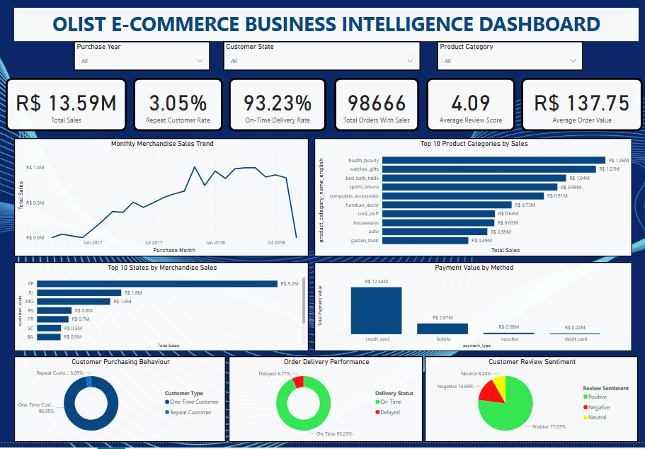
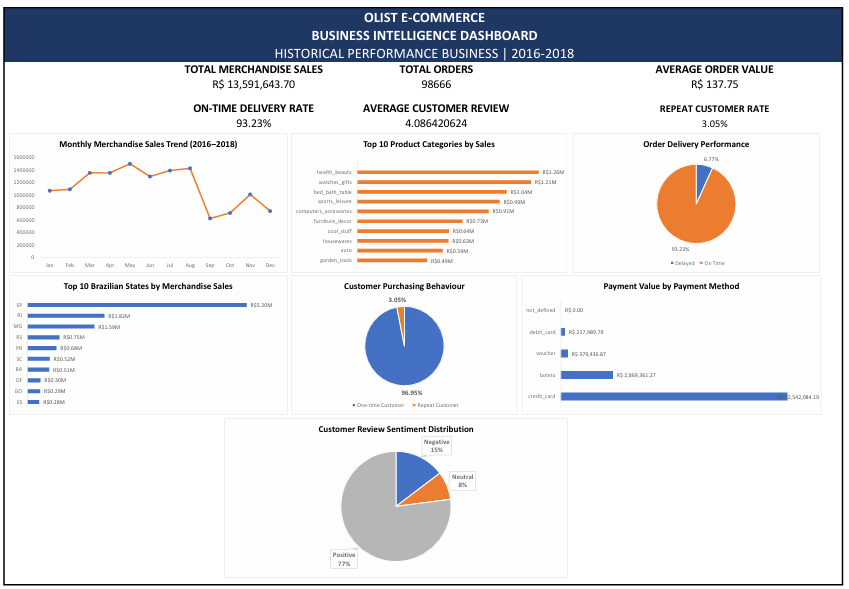

# 🛒 Olist E-Commerce Business Intelligence Analysis

### End-to-End Data Analytics Project | Python • Excel • Power BI

## 📌 Project Overview

## 📊 Dashboard Preview

### Power BI Executive Dashboard



### Microsoft Excel Dashboard



This project presents an end-to-end business intelligence analysis of the Brazilian Olist e-commerce dataset.

The objective is to transform raw transactional data into actionable business insights by analyzing sales performance, customer purchasing behaviour, delivery efficiency, payment preferences, and customer satisfaction.

The project demonstrates the complete data analytics workflow, from data cleaning and exploratory analysis in Python to dashboard development in Microsoft Excel and Power BI.

## 🎯 Business Objectives

The analysis addresses the following business questions:

1. How has merchandise sales performance changed over time?
2. Which product categories generate the highest sales?
3. Which Brazilian states contribute the most to sales?
4. What percentage of customers make repeat purchases?
5. How efficiently are orders delivered?
6. Which payment methods are most popular?
7. How satisfied are customers with their shopping experience?

## 🛠️ Tools and Technologies

| Tool | Purpose |
|---|---|
| Python | Data cleaning and exploratory data analysis |
| Pandas | Data manipulation, merging, and aggregation |
| Matplotlib | Data visualization |
| Microsoft Excel | KPI analysis and business dashboard development |
| Power BI | Data modelling, DAX measures, and interactive dashboards |
| GitHub | Project documentation and version control |

## 📂 Project Structure

```text
olist-ecommerce-business-intelligence/
│
├── README.md
│
├── dashboards/
│   ├── Olist_Ecommerce_Business_Dashboard.xlsx
│   └── Olist_Ecommerce_Business_Intelligence.pbix
│
├── notebooks/
│   └── Python analysis notebook (.ipynb)
│
├── visualizations/
│   └── Python charts (.png)
│
└── data/
    └── Data documentation (optional)
```

*Note: The structure above is illustrative. Actual filenames and folders may differ.*

## 📊 Key Performance Indicators

The analysis produced the following KPIs:

| KPI | Result |
|---|---:|
| Total Merchandise Sales | R$13.59M |
| Total Orders With Sales | 98,666 |
| Average Order Value | R$137.75 |
| Repeat Customer Rate | 3.05% |
| On-Time Delivery Rate | 93.23% |
| Average Customer Review Score | 4.09/5 |

**Metric definitions:**

- **Merchandise Sales:** Sum of product prices, excluding freight charges.
- **Orders With Sales:** Distinct orders containing merchandise sales.
- **Average Order Value:** Merchandise sales divided by orders with sales.
- **Repeat Customer Rate:** Percentage of customers with merchandise sales who placed more than one order.
- **On-Time Delivery Rate:** Percentage of eligible delivered orders received on or before the estimated delivery date, using calendar dates.
- **Average Review Score:** Average customer rating on a five-point scale.

## 🔍 Data Analysis Workflow

### 1. Data Collection

The project uses the Brazilian E-Commerce Public Dataset by Olist, which contains information about orders, customers, products, payments, sellers, deliveries, and customer reviews.

The dataset covers transactions from 2016 to 2018.

### 2. Data Cleaning and Preparation

Python and Pandas were used to:

- Inspect dataset structures and data types.
- Identify missing values and duplicate records.
- Convert date columns into appropriate datetime formats.
- Prepare datasets for analysis.
- Merge related tables using common identifiers.
- Create analysis-ready tables for dashboard development.

### 3. Exploratory Data Analysis

Exploratory analysis focused on:

- Monthly merchandise sales trends.
- Product category performance.
- Sales distribution by state.
- Customer purchasing frequency.
- Delivery performance.
- Payment method preferences.
- Customer review scores and sentiment.

### 4. Excel Dashboard Development

Microsoft Excel was used to develop a business dashboard containing KPI summaries and charts covering the main areas of e-commerce performance.

### 5. Power BI Dashboard Development

Power BI was used to build an interactive executive dashboard.

The development process included:

- Importing cleaned datasets.
- Creating relationships between tables.
- Writing DAX measures for business KPIs.
- Developing charts and KPI cards.
- Adding slicers for interactive analysis.
- Validating key calculations against the Excel analysis.

## 📈 Key Findings and Business Insights

### 1. Sales Performance

The business generated approximately **R$13.59 million in merchandise sales** across **98,666 orders with sales**.

The average order value was **R$137.75**.

The monthly sales analysis provides visibility into business growth and fluctuations over the dataset period.

### 2. Product Category Performance

The leading product categories included:

- Health & Beauty
- Watches & Gifts
- Bed, Bath & Table
- Sports & Leisure
- Computers & Accessories

These categories accounted for a significant portion of merchandise sales.

**Business insight:** High-performing categories represent important opportunities for targeted promotions, product availability planning, and marketing investment.

### 3. Geographical Sales Distribution

Sales were concentrated in a few major Brazilian states.

| State | Merchandise Sales |
|---|---:|
| São Paulo (SP) | R$5.20M |
| Rio de Janeiro (RJ) | R$1.82M |
| Minas Gerais (MG) | R$1.59M |

São Paulo accounted for approximately **38.28% of total merchandise sales**.

**Business insight:** Strong sales concentration in major states suggests opportunities to strengthen established markets while exploring growth in underserved regions.

### 4. Customer Purchasing Behaviour

Customer analysis revealed:

| Customer Type | Percentage |
|---|---:|
| One-Time Customers | 96.95% |
| Repeat Customers | 3.05% |

Only **3.05% of customers** made repeat purchases.

**Business insight:** Customer retention represents a major opportunity. Encouraging existing customers to purchase again could support more sustainable growth.

### 5. Delivery Performance

The delivery analysis showed:

| Delivery Status | Percentage |
|---|---:|
| On-Time | 93.23% |
| Delayed | 6.77% |

The average delivery time was approximately **12.56 days**.

Delivery performance was also associated with customer satisfaction:

| Delivery Performance | Average Review Score |
|---|---:|
| On-Time Deliveries | 4.29/5 |
| Delayed Deliveries | 2.27/5 |

**Business insight:** Delayed deliveries were associated with substantially lower review scores, highlighting the importance of reliable logistics.

### 6. Payment Method Analysis

Credit cards were the dominant payment method.

They accounted for approximately **78.34% of total payment value**, followed by boleto payments.

**Business insight:** The business should prioritize a reliable credit-card checkout experience while continuing to support alternative payment options.

*Note: Payment value includes amounts such as freight and should not be interpreted as merchandise sales.*

### 7. Customer Satisfaction

The average customer review score was **4.09 out of 5**.

Customer review sentiment was distributed as follows:

| Sentiment | Percentage |
|---|---:|
| Positive | 77.07% |
| Neutral | 8.24% |
| Negative | 14.69% |

Most reviews were positive, indicating generally favourable customer experiences.

However, negative reviews highlight opportunities to improve delivery reliability, order fulfilment, and customer support.

## 💡 Business Recommendations

### Improve Customer Retention

Develop customer loyalty initiatives, personalized promotions, and repeat-purchase campaigns to encourage one-time buyers to return.

### Optimize Delivery Operations

Monitor delayed deliveries by region, investigate logistics bottlenecks, and improve delivery estimates.

### Focus on High-Performing Product Categories

Prioritize marketing and product availability for categories that consistently generate strong sales.

### Expand Geographical Opportunities

Use state-level sales insights to identify regions with growth potential and evaluate opportunities for market expansion.

### Strengthen Customer Satisfaction

Analyze negative customer reviews to identify recurring problems and improve the post-purchase experience.

### Improve the Payment Experience

Maintain reliable credit-card processing while supporting alternative payment methods that meet customer preferences.

## 📊 Dashboard Features

### Microsoft Excel Dashboard

The Excel dashboard presents:

- Business KPI summaries
- Monthly sales trends
- Product category performance
- Geographical sales analysis
- Customer purchasing behaviour
- Delivery performance
- Payment analysis
- Customer satisfaction insights

### Power BI Executive Dashboard

The Power BI dashboard includes six KPI cards and seven visualizations:

1. Monthly Merchandise Sales Trend
2. Top 10 Product Categories by Sales
3. Top 10 States by Merchandise Sales
4. Customer Purchasing Behaviour
5. Order Delivery Performance
6. Payment Value by Method
7. Customer Review Sentiment

The report also includes slicers for purchase year, customer state, and product category.

## ⚠️ Data Limitations

- The dataset is historical and covers 2016–2018; findings should not be interpreted as current Olist performance.
- The final period may contain incomplete transaction data, so changes near the end of the timeline should be interpreted carefully.
- Merchandise sales exclude freight, whereas payment totals include additional charges.
- The repeat customer rate reflects customers observed in the dataset and may not capture purchases outside the observation period.
- Delivery performance calculations use eligible orders with the required delivery dates.

## 🏁 Conclusion

This project demonstrates how e-commerce transactional data can be transformed into meaningful business intelligence using Python, Excel, and Power BI.

The analysis identified several opportunities for business improvement, particularly in customer retention, delivery reliability, geographical expansion, and customer satisfaction.

It also demonstrates practical data analytics skills in:

- Data cleaning and preparation
- Exploratory data analysis
- Data visualization
- KPI development
- Data modelling
- DAX calculations
- Dashboard design
- Business insight generation
- Data storytelling

## 📚 Dataset Source

**Dataset:** Brazilian E-Commerce Public Dataset by Olist

**Platform:** Kaggle

**Dataset link:** https://www.kaggle.com/datasets/olistbr/brazilian-ecommerce

## 👤 Author

**Shadrach Ogwuche**

**GitHub:** https://github.com/shadrachogwuche-netizen

---

⭐ If you found this project useful, feel free to explore the analysis, dashboards, and visualizations.
